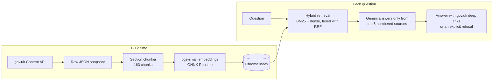

# UK Visa Guidance Assistant (RAG)

A retrieval-augmented question-answering system over official UK visa guidance. Ask about the **Student**, **Graduate** or **Skilled Worker** visa and get a short answer built only from gov.uk guidance, with a link to the exact section each fact came from — or an explicit "I can't find this" when the guidance doesn't cover it.

**Live demo: https://visa-rag-8w20.onrender.com**
(Free hosting: the service sleeps when idle, so the first request can take about a minute while it wakes up and loads the model.)

> Not legal advice. Answers come from a snapshot of gov.uk guidance taken on **12 October 2026**. Always check the linked gov.uk page before acting.

## Why this project

Most production LLM applications answer questions from a specific set of documents the model has never seen, or has only seen an older version of. Visa guidance is a good public stand-in for that problem: it is dense, changes often, and getting a fee or a deadline wrong has real consequences.

The project builds the full pipeline (ingest, chunk, embed, retrieve, generate with citations, refuse when unsure), and then **measures** it: retrieval quality on a labelled eval set, and answer correctness against the same model answering from memory alone.

## Results

### Answers: retrieval vs the same model without it

Same model (Gemini Flash-Lite), same 31 in-scope questions, same instructions and the same option to refuse. The only difference is whether the model is given retrieved sources.

| In-scope questions (31) | With retrieval (RAG) | Model alone |
|---|---|---|
| Correct | 27 | 21 |
| Partially correct | 1 | 2–4 |
| **Incorrect** | **0** | **5–7** |
| Refused | 3 | 1 |
| **Out-of-scope questions refused (of 4)** | **4** | **0** |

The model alone was wrong mostly on facts that have changed: older fees, salary thresholds and dates.

| Question | Model alone | Guidance snapshot |
|---|---|---|
| Student visa fee | £490 | £558 |
| Monthly living costs outside London | £1,023 | £1,171 |
| Graduate visa fee | £822 | £937 |
| Skilled Worker minimum salary | £38,700 | £41,700 |
| Graduate visa length if applying in 2027 | 2 years | 18 months |

The RAG system's 3 refusals are exactly the 3 questions where retrieval failed to find the right section. It declines rather than guessing.

### Retrieval

Hit rate@k = share of questions where a correct section appears in the top k results. MRR rewards ranking it higher.

| Retriever | hit@1 | hit@3 | hit@5 | MRR |
|---|---|---|---|---|
| Keyword (BM25) | 51.6% | 67.7% | 80.6% | 0.618 |
| Dense embeddings (bge-small) | 58.1% | 87.1% | 90.3% | 0.711 |
| **Hybrid (Reciprocal Rank Fusion)** | **74.2%** | **90.3%** | **90.3%** | **0.806** |

Keyword search fails on wording mismatches ("Canadian" vs "Canada", "wife" vs "partner"); embeddings and keywords miss *different* questions, which is why combining them helps. The eval set is small (each question is worth about 3 percentage points), so differences of one or two questions are not meaningful.

## How it works



1. **Ingest.** The three visa guides are fetched as structured JSON from the [GOV.UK Content API](https://content-api.publishing.service.gov.uk/) rather than scraped, and saved as a committed snapshot so every evaluation runs on the same text.
2. **Chunk.** Each guide part is split at its `<h2>` headings, following the authors' own structure; sections too long for the embedding model's 512-token limit are split again at their `<h3>` headings. Each chunk keeps its heading path (e.g. *Student visa > Money you need > Course fee*) and a deep link to its exact section.
3. **Embed and index.** `BAAI/bge-small-en-v1.5` embeddings, run with ONNX Runtime, stored in Chroma.
4. **Retrieve.** BM25 keyword search and dense search each rank the chunks; Reciprocal Rank Fusion combines the two rankings.
5. **Generate.** Gemini receives the top 5 chunks as numbered sources and must cite them (`[1]`, `[2, 3]`), may apply a stated rule to the user's situation, and must reply with a fixed refusal sentence when the needed rule isn't in the sources. Citations are parsed back into gov.uk links.

## Evaluation method

- **Eval set:** 35 questions (24 standard, 7 hard, 4 out of scope), phrased the way a person would ask rather than in gov.uk's wording. Each is labelled with every chunk that contains the answer. Questions were drafted with LLM assistance and every label was checked against the source text.
- **Hard cases** include old and current rules side by side (pre-April 2024 Skilled Worker salary rules), a date-dependent rule (the Graduate visa change for 2027), and an answer buried in a long country list.
- **Answer correctness** is graded by an LLM judge against a reference answer. The judge was checked by blind human grading of 20 answers, deliberately weighted towards hard cases: **80% agreement, Cohen's kappa ≈ 0.68**. All disagreements were one grade apart and on the model-alone answers, which is why those are reported as ranges.
- **One prompt revision only.** After the first run showed the model refusing questions it could answer by applying a rule to the user's situation, the prompt was changed once, on a general principle, and both versions were kept. It was not tuned repeatedly against the eval set.

## Engineering notes

- **Memory.** With PyTorch, the embedding stack peaked at 514 MB, over the hosting limit of 512 MB. Running the *same* model on ONNX Runtime instead produced identical vectors (similarity 1.0000) and identical retrieval scores, and the container now uses **214 MiB under a 512 MiB limit** after a real request (`docker run --memory=512m`).
- **Pluggable embeddings.** An `EmbeddingBackend` interface with ONNX and PyTorch implementations, selected by the `EMBEDDING_BACKEND` environment variable without importing PyTorch unless it's used.
- **Build-time index.** The Docker build downloads the model and builds the index, so the running service never downloads anything at startup.
- **CI.** GitHub Actions builds the image and starts the container to check that `/health` responds, which catches startup failures a build alone would miss.
- **Robustness.** Rate limiting and retries for transient API errors; errors are logged server-side and returned to the user as a clear message; model output is HTML-escaped before display.

## Run it locally

Requires Python 3.13 and a Gemini API key.

```bash
git clone https://github.com/jeno11/visa-rag.git
cd visa-rag
python -m venv .venv && source .venv/bin/activate
python -m pip install -r requirements.txt

cp .env.example .env          # then add your LLM_API_KEY
python -m src.build_index     # embed the chunks into a local Chroma index
python -m uvicorn src.api:app --reload
```

Open http://127.0.0.1:8000. API docs are at `/docs`.

Or with Docker:

```bash
docker build -t visa-rag .
docker run --rm -p 8000:8000 --env-file .env visa-rag
```

`requirements.txt` contains what the service needs. Re-running ingestion and chunking also needs `requests` and `beautifulsoup4`; the PyTorch embedding backend and some scripts need `sentence-transformers`. The evaluations need an API key and take several minutes because of free-tier rate limits.

| Command | What it does |
|---|---|
| `python -m src.ingest` | Fetch a fresh snapshot from the Content API |
| `python -m src.chunk` | Rebuild `data/chunks.jsonl` from the snapshot |
| `python -m src.evaluate_retrieval` | Retrieval metrics for BM25, dense and hybrid |
| `python -m src.evaluate_answers` | RAG and model-alone answers for every eval question |
| `python -m src.judge` | Grade the answers against the reference answers |
| `python -m src.ask "your question"` | Ask a question from the command line |

## Project structure

```
src/
  ingest.py, chunk.py          snapshot from the Content API, section chunking
  embeddings/                  EmbeddingBackend interface, ONNX and PyTorch backends
  build_index.py, search.py    Chroma index and dense retriever
  bm25.py, hybrid.py           keyword retriever, Reciprocal Rank Fusion
  generate.py, ask.py          cited answer generation, command-line interface
  api.py                       FastAPI service (/ask, /health)
  evaluate_retrieval.py        hit@k and MRR
  evaluate_answers.py, judge.py  answer evaluation and LLM judge
scripts/                       one-off checks (token lengths, backend comparison, human judge check, ...)
static/index.html              web interface
data/raw/                      gov.uk snapshot (12 Oct 2026)
data/chunks.jsonl              163 chunks
data/eval/questions.jsonl      35-question eval set
results/                       saved evaluation outputs
```

## Limitations and next steps

- **Small eval set.** 31 scored questions is enough to show clear differences, not precise percentages.
- **Coverage is only as good as the corpus.** Some common questions (for example, weekly working hours for students) aren't answered in these three guides, so the system correctly refuses. Adding the official route guidance would close that gap.
- **Two chunking limitations.** A subheading inside a short section doesn't become part of that chunk's heading path, and one fact sits in a warning box under an unrelated heading. Both cause retrieval misses on specific questions.
- **The snapshot ages.** Rules change, so the snapshot date is shown with every answer. A scheduled re-ingest with a check for changed pages would be the natural next step.
- **Hosted model variability.** Even at temperature 0, repeated runs can differ slightly.

## Licence and attribution

Contains public sector information licensed under the [Open Government Licence v3.0](https://www.nationalarchives.gov.uk/doc/open-government-licence/version/3/). This project is not affiliated with or endorsed by the UK Government or UK Visas and Immigration.
